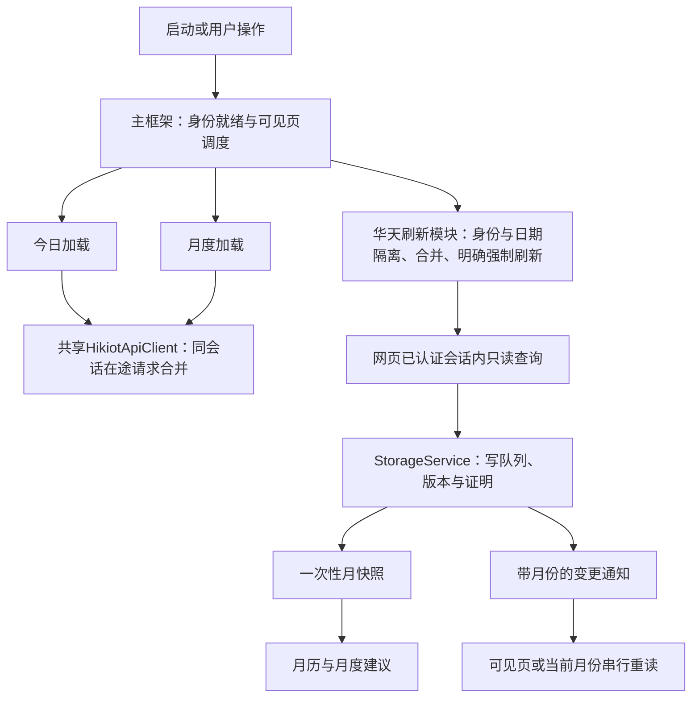

# 华云工时｜性能体检与刷新架构优化（2026-11-15）

## 范围与证据口径

基于2.12.1，检查启动、导航、回前台、每日/月度考勤、华天整月/单日、填报确认、缓存读写、通知、后台WebView及界面动画。对可复现的重复操作建立真实模块或Widget请求计数回归，再修复；没有用桌面测试耗时冒充手机帧率，没有使用真实密码或提交真实日报。

## 已复现问题

| 场景 | 修改前证据 | 处理方式 |
| --- | --- | --- |
| 连点当前今日标签5次 | 考勤总读取1变6 | 导航同页直接返回，显式下拉仍刷新 |
| 初始化期间导航 | 身份未就绪时提前请求，月度未完成时重复加载 | 启动阶段由唯一协调器拥有刷新职责 |
| 启动串行等待 | 整月未完成时今日读取仍为0 | 身份完成后今日/月度并行，今日先可用；月底核对等待两者完成 |
| 月度缓存初始化 | 页面后台quick和主框架quick重复2次 | 主框架统一启动刷新，API结果不再追加quick，缓存最多1轮 |
| 月度与单日重叠 | 同客户端同日并发HTTP2次 | 仅合并在途读取，完成后再请求仍取新值；token/团队变更拒绝迟到结果 |
| 隐藏日志页 | 尚未打开就读取整周缓存 | 延迟到首次进入再创建内容 |
| 日报回写通知 | 周条读取总3次 | 统一依赖缓存通知，去掉成功分支重复刷新 |
| 月度只读核对 | 每次4次同值原生写入、31次逐日异步证明读取 | 迁移字段仅差异写；金额/证明一次快照读取 |
| 月底通知风暴 | 20次更新产生21次同时计算 | 展示刷新串行合并为当前计算加最终重读；提交校验仍即时读取 |
| 启动画面 | 人工固定等待1秒 | 本地状态就绪即可导航 |
| 同日连续10次被动刷新 | 每次打开新会话，共10次 | 当前身份30秒内的有效确认复用1次；强制刷新仍查询 |
| 同轮10次强制刷新 | 旧查询加10个排队新查询，共11次 | 当前查询加一次后续强制核对，共2次 |
| 已有整月查询时又读单日 | 额外查询1次 | 等整月结果并核对当日证明，额外0次 |
| 重读已规范化设置 | 每次14次原生持久化 | 仅差异字段写入，重读0次 |
| 10ms后就绪的网页会话 | 固定轮询导致中位503.57ms | 首秒100ms后退避，桌面替身中位103.688ms |

详细红绿证据在hikiot_worktime/build/reports/，包括ui-lifecycle-before、ui-work-log-before、month-startup-before、attendance-coalescing-before、monthly-perf-before、reminder-perf-before及对应回归日志。

## 刷新架构

页面负责展示和表达用户意图；刷新模块负责去重、新鲜度和失败处理；存储负责写入顺序及读取一致性。继续使用现有模块和注入方式，没有加入另一套状态管理框架，也没有为了减少请求取消必要的确认。

## 保留的必要工作与待验证项

- 提交前查重、最终用户确认、写入后回读、月度建议采用前和提交前数据核对必须保留。结果未知的写入不会自动重放。
- 单日和部分提交脚本仍使用同步XHR：它会阻塞该网页JS，但没有证据说明它直接造成Flutter渲染掉帧；后续需真机数据决定异步化范围。
- 每个实际华天操作仍有隐藏WebView生命周期；本轮通过减少多余操作降低创建次数，没有共享一个永久携带认证状态的WebView。
- 缓存证明新增按日期的已验证账号所属，避免跨身份合并或复用。旧无所属证明的数据需首次重新确认，之后同账号新鲜月/日缓存支持冷启动零网络复用；少量证明孔洞只补相关日期。被动30秒窗口不等同服务端实时，提交前实时查重独立执行。
- 现有会话timeout约束就绪等待，不是整项操作截止；网络慢或写入结果未知必须明确显示，不能把超时等同可重试。
- 未发现每日/日志页面存在每秒整页刷新计时器；设置页的每秒计时器属于独立倒计时弹窗，超时闪烁组件也已有按需Ticker控制。未将这些代码列为已证实瓶颈。
- 多个页面仍较大，后续按稳定业务职责逐步拆分；文件长度本身不是运行时卡顿证据，不在本轮做无证据的大规模拆文件。
- SharedPreferences测试计时受VM与并行测试负载影响，主要验收请求数、写入数、最大并发和界面就绪顺序；真实iPhone帧时间、滚动手感和网络耗时仍需实机采样。

## 验证结果

全套980项测试通过，静态分析无问题。请求调度62项、UI/startup53项、存储与建议98项、会话探测30项等定向回归先行验证，再完成全套集成。回归使用生产模块和真实调用层级，HTTP/原生网页依赖使用可控替身。

候选版本2.12.2+21；Android/iOS构建结果及源码推送在操作记录中单独记录。HTML主报告为hikiot_worktime/build/reports/huayun-performance-health-2026-11-15.html，桌面和390px宽度布局、分类筛选已通过浏览器检查。公开发布与手机安装不等于源码优化完成，本轮报告明确各状态。
